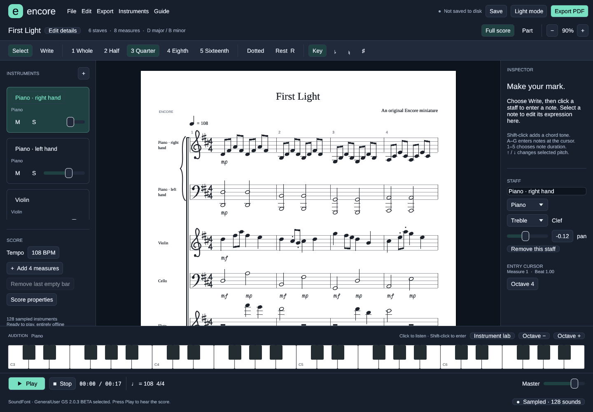
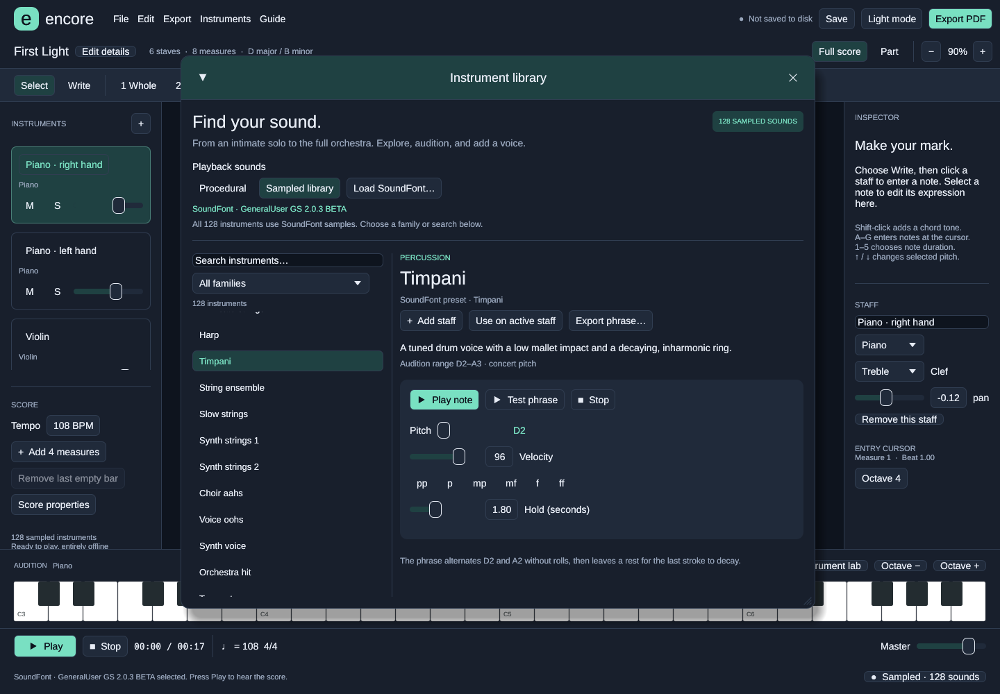

# Encore

An original Rust desktop application for composing, engraving and hearing music. Encore uses its own score model, interface, vector notation, procedural instruments and SoundFont sample playback. It includes no Finale proprietary code or assets. Foreign score readers use public specifications and independent format documentation.



## Run

```sh
./run-encore
```

The launcher uses the compiled release when available and otherwise builds it. Rust 1.88 or later is required to build. The current checkout includes a downloaded dependency cache under `.build`; it is ignored by Git. For a fresh checkout:

```sh
cargo run --release --locked
```

The native application supports Linux, Windows and macOS through eframe and rodio. This release has been built and tested on Linux. Native Windows/macOS packaging and CI jobs are prepared; those builds still need validation on their respective hosts. See [BUILDING.md](BUILDING.md). Linux builds require the ALSA development library, pkg-config, a C toolchain and the usual X11/Wayland graphics development libraries. File dialogs use the desktop portal on Linux.

## Compose

Use **Light mode / Dark mode** in the header to switch appearance. Encore remembers the choice between launches and keeps score paper white. [Preview the light appearance](examples/Encore-Light.png).

Encore opens **First Light**, an original eight-bar ensemble miniature. Press **Space** to listen. **File → New score** starts an empty piano grand staff. Browse sounds with **Instruments** in the top menu or **+** in the Instruments panel. The editor uses dark panels, clear transport controls and a light score page.

**File → Demo: Carol of the Bells — Epic** loads **Winter Ascendant**, the second demonstration score. Its 80-second, 16-staff orchestration begins with four low timpani statements, followed by a bowed E1 double bass whole note. Strings gather around that foundation, woodwinds and brass emerge, a quiet middle passage clears the texture, and ascending strings lead to the full-orchestra finale. The familiar bell cell comes from *Shchedryk*, associated with Mykola Leontovych; the orchestration and development here are original. See the [Kyiv Polytechnic account of the melody](https://kpi.ua/en/shchedryk).

The rendered audio, editable project, full score and a reduced opening score are in `examples/` under `Carol of the Bells - Epic` and `Carol of the Bells - Opening`.

- Choose **Write**, select a duration and click a staff to insert a note. **Shift-click** an existing event to add a chord tone with that event's duration.
- **1–5** selects whole, half, quarter, eighth or sixteenth notes. **R** toggles rest entry; **.** toggles dotted entry. The accidental controls choose the key signature, flat, natural or sharp.
- **A–G** enters notes at the cursor using the inspector's octave. **Enter** inserts the current rest or a C. Entry advances to the next position and adds a measure when necessary.
- In **Select** mode, click a note to edit it, or click empty staff space to move the entry cursor. **Left/Right** moves the cursor by the current duration.
- The Inspector edits note duration, dots, velocity, staccato and ties. **Up/Down** transposes selected notes by one semitone; **Shift+Up/Down** transposes by an octave. **Delete** removes an event.
- **Ctrl+Z** undoes; **Ctrl+Shift+Z** or **Ctrl+Y** redoes. **Ctrl+S** saves; **Ctrl+Shift+S** saves as; **Ctrl+O** opens; **Ctrl+N** creates a score. On macOS, use Command.
- **M/S** mutes or solos a staff. Staff volume and pan control its mix. Editing a playing score stops playback so the next play reflects the changes.
- Click the piano keyboard to audition the active instrument; **Shift-click** a key to enter it into the score. **Space** plays/pauses the score; **Escape** stops.

The editor prevents overlapping events and notes extending past a barline. Enter longer notes as tied notes in adjacent measures. Empty space is engraved and exported as rests. Key-signature changes retain existing pitch spellings; new notes use the new signature.

## Save, print and exchange

**File → Open** now accepts MusicXML (`.musicxml`, `.xml`, `.mxl`), MuseScore (`.mscx`, `.mscz`, versions 2–4), and a supported subset of modern Finale `.musx` files. Imported scores save as new Encore projects; import notes explain feature losses. Legacy Finale `.mus`, Finale `.lib` settings libraries, and Garritan/ARIA plug-ins are not directly supported. See [COMPATIBILITY.md](COMPATIBILITY.md) for the precise limits and Finale 27 migration workflow.

**.encore** is a validated, readable JSON project format, saved atomically. Existing projects retain their original instrument identities. Projects using the additional `GeneralMidi` instruments require Encore 0.4 or later. The application warns before closing or replacing unsaved work. Undo/redo is kept in memory for the last 100 changes.

The **Export** menu produces:

| Format | Use |
| --- | --- |
| PDF | Multipage letter-size sheet music; open it in a PDF viewer to print. Text and notation are vector outlines, so no external music or text fonts are needed. |
| SVG | Vector pages; additional pages are saved beside the chosen file with `-2`, `-3`, etc. |
| MusicXML 4.0 | Score interchange with notation applications, preserving written pitches, timing, chords, dynamics, instruments and ties. |
| MIDI | Type-1 performance with tempo, programs, channels/ports, volume, pan, dynamics, ties, staccato and mute/solo. |
| WAV | 44.1 kHz, 16-bit stereo audio using the selected sampled or procedural engine. |

Choose **Part** above the score to view the active staff. PDF and SVG export follow the current full-score/part view. MusicXML, MIDI and WAV export the complete score, with mute/solo affecting MIDI and WAV playback.

## Instruments

Version 0.5 exposes **all 128 melodic General MIDI instruments**, played through the bundled 31 MiB GeneralUser GS SoundFont by default. The collection includes acoustic and electric pianos, mallets, organs, guitars, basses, solo and ensemble strings, choirs, brass, saxophones, woodwinds, synthesizer leads and pads, world instruments, pitched percussion and sound effects. All 128 use SoundFont sample playback; electronic and effect presets are sampled or synthesized sound designs, rather than recordings of 128 acoustic instruments. No network access or additional asset download is required during use.

Open **Instruments** in the top menu, **+** in the Instruments panel, or **Instrument lab** above the piano keyboard to open the **Instrument library**. Search by name or filter by family. Select a sound to see its actual SoundFont preset, character notes and concert-pitch audition guide. Use the pitch, velocity and hold controls for a single note, or play a four-bar test phrase. **Add staff** creates a new part; **Use on active staff** changes the current part's sound and clef while preserving its notes. **Export phrase…** saves the audition as a WAV. Additional GM voices have useful keyboard audition ranges, which are not claims about an acoustic instrument's physical compass.

OxiSynth, a Rust SoundFont engine, plays the bank's samples with their envelopes, loops, filters and velocity/control modulators. Woodwinds and harp now use samples alongside piano, bowed strings, brass and timpani. **Double bass** is the sustained bowed contrabass preset; **Acoustic bass** in the Bass family is plucked. The bundled bank has conservative instrument-level trims for the original orchestral palette; additional GM sounds retain their native bank balance. Note velocities and the score's mixer values are preserved.

In the library's **Playback sounds** controls, choose **Sampled library** or **Procedural**. The selected source applies to the score, keyboard auditions, test phrases and WAV exports. **Load SoundFont…** accepts an SF2 bank containing all 128 melodic bank-0 GM programs. A missing preset or corrupt bank produces a visible error and retains the current engine. An explicitly invalid `ENCORE_SOUNDFONT` at startup produces a visible warning and procedural fallback. Banks are loaded once and shared across render jobs. The upstream GeneralUser GS bank contains 261 presets and 13 drum kits; this version exposes its 128 melodic bank-0 programs. GS variations and drum-kit selection are not implemented.

For a direct comparison, listen to `examples/Carol of the Bells - Sampled.wav` and `examples/Carol of the Bells - Procedural.wav`. Matching 16-second opening excerpts are named `Carol of the Bells - Opening - Sampled.wav` and `Carol of the Bells - Opening - Procedural.wav`. Both play the same unmodified 80-second score and mix settings, with the engine's final release tail appended. The sampled render is also the current `Carol of the Bells - Epic.wav`. The procedural files preserve the original comparison baseline.

The optional procedural engine retains the original 18 instrument voices with register-dependent resonances, velocity-dependent color and reproducible variation between strokes. Piano models string beating and hammer excitation; bowed strings use moving partials, woodwinds and brass use instrument-specific resonances, and timpani uses tuned membrane modes. The additional 110 GM choices use related procedural family approximations in this mode. Choose **Sampled library** to hear each bank preset's distinct sound. Both engines share stereo room reflections and soft limiting.

The score keyboard starts in a useful register for the active staff; **Octave −/+** moves through the remaining range. Auditions reuse an audio output rather than opening a new device for every key.



## Command line

```sh
./run-encore examples/First\ Light.encore
./run-encore --demo exports
./run-encore --demo-carol exports
./run-encore --demo-all exports
./run-encore --compare-carol exports/comparison
./run-encore --procedural --demo-carol exports/procedural
./run-encore --soundfont /path/to/bank.sf2 --instruments exports/sampled
./run-encore --export examples/First\ Light.encore exports/score.pdf
./run-encore --export examples/First\ Light.encore exports/performance.wav
./run-encore --validate examples/First\ Light.encore
./run-encore --import source.mscz converted.encore
./run-encore --export source.mxl score.pdf
./run-encore --instruments exports/instruments
./run-encore --audio-check
cargo test --locked --all-targets
```

The demo commands write native scores, PDF, SVG pages, MusicXML, MIDI and WAV. The Carol command also writes an eight-bar timpani/bass opening PDF. `--instruments` writes 128 four-bar WAV auditions, one for each melodic GM instrument, in useful keyboard registers. `--compare-carol` renders the same Carol score with both engines and writes matching opening excerpts. `--procedural` and `--soundfont PATH` select a backend for command-line audio operations and can appear before or after the command. `ENCORE_SOUNDFONT=/path/to/bank.sf2 ./run-encore` selects a bank for desktop startup; otherwise Encore discovers the bundled bank beside the application or in the source tree. Export destination directories must already exist, except directories created by the demo and instrument commands.

## Verification

The Linux build passes 125 automated tests and Clippy with warnings denied. Import coverage includes a licensed real Finale 27.4.1.146 file and a public MuseScore score checked against all 64 original pitches. Theme switching, preference storage and source-file preservation are also tested. Coverage includes score persistence, all 128 program identities and native round trips, MIDI/MusicXML timing and program exports, engraving, the original 18 procedural voices, and the complete sampled catalog. Recorded-bank checks verify finite audible output for all 128 presets, bowed-bass sustain and release, low timpani resonance, velocity response, mute/solo behavior, ties, staccato, malformed or incomplete banks and recovery of the shared bank after an interrupted renderer. UI checks cover library search and family filters, instrument replacement and undo, engine errors, stale playback cancellation, keyboard input and Escape stopping auditions while the library is open. Both editor and library are rendered with actual egui meshes and fonts in display-independent tests.

The sampled Carol render contains 80 seconds of music plus a three-second release tail. The procedural comparison retains its 1.8-second tail and is byte-for-byte identical to the previous procedural render. Both are 44.1 kHz, 16-bit stereo with no clipped PCM samples. Printed notation and the editable score are unchanged.

To reproduce the editor image without a display server:

```sh
ENCORE_HEADLESS_SCREENSHOT=/tmp/encore.ppm cargo test --bin encore headless_full_editor
ENCORE_LAB_SOUNDFONT="$PWD/assets/soundfonts/GeneralUser-GS.sf2" \
ENCORE_LAB_SCREENSHOT=/tmp/encore-lab.ppm cargo test --bin encore headless_instrument_lab
```

## Current scope

Encore 0.5 supports one rhythmic voice per staff, with chords; piano uses separate right- and left-hand staves. Add another staff for independent rhythms. All notation and playback use **concert pitch**.

This version does not yet support tuplets, lyrics, slurs, repeat playback, percussion maps, transposing-instrument parts, MIDI keyboard input or MIDI import. Foreign-score import is bounded by the same model; direct Finale support covers a subset of `.musx`, while legacy `.mus` requires conversion through MusicXML. Ties are forward connections to matching pitches at the next contiguous event. Large ensembles are divided into staff groups across pages. Audio renders up to ten minutes in memory; notation and MIDI can be longer. The native model supports up to 64 staves, 1,024 measures and 200,000 events, with up to 16 pitches in a chord. Project files are limited to 16 MiB.

## Source

| Module | Responsibility |
| --- | --- |
| `src/model.rs` | Score, pitch spelling, validation, demo, atomic project persistence |
| `src/engraving.rs` | Layout, original notation glyphs, hit maps, SVG and PDF |
| `src/synth.rs` | Procedural voices, shared room/mix processing, WAV and rodio playback |
| `src/sampled.rs` | Validated SF2 loading, all 128 GM presets and sampled event scheduling |
| `src/audio.rs` | Shared engine selection, bank discovery and render validation |
| `src/instruments.rs` | Concert-pitch and keyboard audition guides, character notes and phrases |
| `src/demos.rs` | Winter Ascendant orchestration and section map |
| `src/export.rs` | MusicXML and MIDI |
| `src/import.rs`, `src/import/` | Bounded MusicXML, MuseScore and modern Finale readers with import notes |
| `src/app.rs` | Native editor, input, inspector, mixer, history, transport |
| `src/main.rs` | Desktop startup and command-line exports |

Encore code is MIT licensed. Bundled Liberation Serif/Sans fonts are distributed under the SIL Open Font License in `assets/Serif-LICENSE.txt`; their outlines are used for portable printed text. Noto Music provides interface symbols under `assets/Music-LICENSE.txt`. The GeneralUser GS bank and its documentation retain their original license in `assets/soundfonts/GeneralUser-GS-LICENSE.txt`; see `assets/soundfonts/NOTICE.md` for source and checksum. OxiSynth is LGPL-2.1; its license and source/rebuild information are included under `assets/third-party/`. Other Rust libraries retain their respective licenses.
